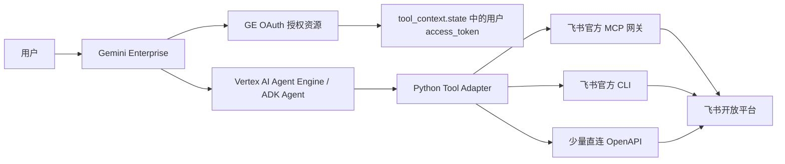

# 基于 ADK 集成飞书生态技术方案

## 1. 背景与目标

本方案面向一个明确目标：基于 Google ADK 开发 Agent，并部署到 Vertex AI Agent Engine / Gemini Enterprise，让企业用户可以在统一 AI 入口中操作飞书生态。

当前验证结论：

- 飞书官方 MCP 可以集成到 ADK Agent，用于云文档等能力。
- 飞书 CLI 可以集成到 ADK Agent，用于更广泛的飞书生态操作。
- Gemini Enterprise 可以托管 OAuth 授权流程，Agent 工具侧通过 `tool_context.state[f"{LARK_AUTH_ID}"]` 获取用户态 `access_token`。

因此，推荐采用混合架构：

**ADK / Gemini Enterprise 作为主控编排层，飞书 MCP 和飞书 CLI 作为能力执行层。**

## 2. 总体架构



### 核心分层

| 层级 | 职责 | 当前实现 |
|---|---|---|
| 对话与编排层 | 理解用户意图、选择工具、组织回答 | `google-adk` / `LlmAgent` |
| 授权层 | 用户 OAuth、令牌托管、会话态 token 注入 | Gemini Enterprise Authorization |
| 工具适配层 | 定义 ADK tools、参数校验、错误标准化 | `lark_agent/tools.py` |
| MCP 能力层 | 高保真文档创建、更新、读取 | `call_feishu_mcp_tool` |
| CLI 能力层 | Docs、Drive、IM、Calendar、Task、Base 等生态操作 | `CLIClient` |
| API 补位层 | 少量特殊 OpenAPI 调用 | `execute_lark_api` |

## 3. 授权方案

### 3.1 GE 托管 OAuth

部署到 Gemini Enterprise 后，飞书 OAuth 由 GE 侧授权资源托管。用户首次使用需要完成登录授权，后续 Agent 工具通过 ADK 的 `tool_context` 获取当前用户 access token。

当前工具取 token 的方式：

```python
access_token = tool_context.state.get(f"{LARK_AUTH_ID}")
```

关键配置：

| 配置 | 说明 |
|---|---|
| `LARK_AUTH_ID` | GE 中 authorization resource 的 ID，必须和注册时一致 |
| `LARK_CLIENT_ID` | 飞书开放平台应用 App ID |
| `LARK_CLIENT_SECRET` | 飞书开放平台应用 App Secret |
| `LARK_DOMAIN` | 飞书开放平台域名，如 `https://open.feishu.cn` |

### 3.2 用户态与机器人态

当前优先采用用户态 access token：

- 适合访问用户自己的文档、日历、任务、消息等资源。
- 权限边界与用户真实权限一致。
- 更适合 Gemini Enterprise 场景。

后续如果引入机器人主动通知、群消息推送等能力，可以按业务场景补充 tenant/bot token。

## 4. 飞书 MCP 集成方案

### 4.1 适用场景

MCP 适合高保真、结构化、文档相关能力：

- 创建飞书云文档
- 更新飞书云文档
- 读取飞书云文档 Markdown
- 大文档异步任务轮询
- 对外保持标准工具协议的能力封装

### 4.2 调用方式

当前通过 JSON-RPC 2.0 直接调用飞书官方 MCP 网关：

```text
POST https://mcp.feishu.cn/mcp
```

关键 header：

| Header | 说明 |
|---|---|
| `X-Lark-MCP-UAT` | 用户态 access token |
| `X-Lark-MCP-TAT` | 租户态 token，当前不是主路径 |
| `X-Lark-MCP-Allowed-Tools` | 本次允许调用的 MCP tool name |

当前实现：

- [lark_agent/infrastructure/lark_api_repository.py](/Users/apple/Project/Git/adk-agents/lark_agent/infrastructure/lark_api_repository.py)
- `call_feishu_mcp_tool`
- `_normalize_mcp_tool_result`
- `_extract_mcp_result`

### 4.3 已封装工具

| ADK Tool | MCP Tool | 说明 |
|---|---|---|
| `feishu_mcp_create_doc` | `create-doc` | 创建云文档 |
| `feishu_mcp_update_doc` | `update-doc` | 更新已有文档 |
| `feishu_mcp_fetch_doc` | `fetch-doc` | 读取文档 Markdown |
| `save_ai_output_to_feishu_doc` | `create-doc` | 将 AI 输出写入新文档 |
| `save_ai_output_to_existing_feishu_doc` | `update-doc` | 将 AI 输出追加或替换到已有文档 |
| `wait_for_feishu_doc_create_task` | `create-doc` with `task_id` | 轮询创建任务 |
| `wait_for_feishu_doc_update_task` | `update-doc` with `task_id` | 轮询更新任务 |

### 4.4 返回结果处理

飞书 MCP 常见返回格式是：

```json
{
  "content": [
    {
      "type": "text",
      "text": "{\"doc_id\":\"...\",\"doc_url\":\"...\"}"
    }
  ]
}
```

Agent 不应直接解析这类嵌套文本。当前适配层会统一解包为结构化 dict，方便模型读取：

```json
{
  "status": "success",
  "doc_id": "doxcn...",
  "doc_url": "https://...",
  "message": "文档创建成功"
}
```

## 5. 飞书 CLI 集成方案

### 5.1 适用场景

CLI 适合覆盖更广的飞书生态能力：

- Drive 文件管理
- Docs 常规创建、更新、删除
- IM 消息发送、回复、搜索
- Calendar 日程查询、创建、更新
- Task 任务查询、创建、更新
- Base / Sheets / Slides 等复杂域能力
- 直接调用任意飞书 OpenAPI

### 5.2 调用方式

当前通过 Python `subprocess.run` 调用打包进项目的 `lark-cli` 二进制。

实现位置：

- [lark_agent/infrastructure/cli_client.py](/Users/apple/Project/Git/adk-agents/lark_agent/infrastructure/cli_client.py)

关键环境变量：

| 环境变量 | 说明 |
|---|---|
| `LARKSUITE_CLI_APP_ID` | 飞书应用 App ID |
| `LARKSUITE_CLI_USER_ACCESS_TOKEN` | 当前用户 access token |
| `LARKSUITE_CLI_NO_UPDATE_NOTIFIER` | 禁用更新提示 |
| `LARKSUITE_CLI_NO_SKILLS_NOTIFIER` | 禁用技能同步提示 |

每次调用会创建隔离的临时 `HOME`，避免 CLI 状态污染不同请求。

### 5.3 已封装工具

| ADK Tool | CLI 能力 | 说明 |
|---|---|---|
| `create_lark_document` | `docs +create` | 通过 CLI 创建文档 |
| `update_lark_document` | `docs +update` | 通过 CLI 更新文档 |
| `delete_lark_document` | `drive +delete` | 删除文档或文件 |
| `execute_lark_api` | `api METHOD PATH` | 通用 OpenAPI 调用 |

### 5.4 通用 OpenAPI 工具

`execute_lark_api` 是 CLI 路线的通用补位能力。它允许在没有专用 ADK tool 时调用任意飞书 OpenAPI：

```python
execute_lark_api(
    method="GET",
    path="/open-apis/calendar/v4/calendars",
    params={...},
    data={...},
)
```

建议仅用于以下场景：

- 快速验证新飞书能力
- 某个 API 暂无专用工具封装
- 低风险查询类接口

不建议长期让模型自由拼接高风险写接口。生产化时应把高频能力封装成明确 ADK tool。

## 6. MCP 与 CLI 的分工

| 能力类型 | 推荐路径 | 原因 |
|---|---|---|
| 文档高保真创建/更新/读取 | MCP | Markdown / 富文本保真度更高，工具语义清晰 |
| AI 输出写入飞书文档 | MCP | create/update + task_id 轮询已经完成闭环 |
| Drive 文件删除、移动、搜索 | CLI | CLI 对 Drive 操作封装更完整 |
| IM、Calendar、Task | CLI | 生态覆盖广，便于快速扩展 |
| Base、Sheets、Slides | CLI | API 面广，直接手写成本高 |
| 少量特殊接口 | OpenAPI / CLI api | 作为补位，后续再沉淀成专用工具 |

推荐原则：

- 文档内容保真优先 MCP。
- 生态覆盖优先 CLI。
- 稳定高频能力沉淀为专用 ADK tool。
- 原始 OpenAPI 调用只作为验证和补位。

## 7. Agent 工具设计原则

### 7.1 不直接暴露底层命令

模型不应自由拼接完整 CLI 命令，也不应直接暴露任意 MCP JSON-RPC payload。

推荐做法：

- 用 Python 函数定义稳定 ADK tool schema。
- 工具内部再路由到 MCP、CLI 或 OpenAPI。
- 统一返回 `{status, message, data}` 风格结果。

### 7.2 写操作要收敛成业务工具

例如“把 AI 输出写到飞书文档”，不要让模型自己决定标题去重、create/update、task_id 轮询。

当前已经封装：

- `save_ai_output_to_feishu_doc`
- `save_ai_output_to_existing_feishu_doc`
- `wait_for_feishu_doc_create_task`
- `wait_for_feishu_doc_update_task`

### 7.3 高风险能力要明确参数

删除、覆盖、批量更新等能力建议：

- 要求明确资源 ID。
- 工具描述中写清楚风险。
- 默认优先 append / replace_range，慎用 overwrite。
- 不让模型在没有上下文时自动执行删除。

## 8. 当前能力闭环

### 8.1 新建飞书文档

流程：

1. 用户提出生成内容并写入飞书文档。
2. Agent 生成 Markdown。
3. 调用 `save_ai_output_to_feishu_doc`。
4. MCP `create-doc` 创建文档。
5. 返回 `doc_id`、`doc_url`。

### 8.2 更新已有文档

流程：

1. 用户提供 `doc_id` 或文档 URL。
2. Agent 生成要追加或替换的 Markdown。
3. 调用 `save_ai_output_to_existing_feishu_doc`。
4. MCP `update-doc` 更新文档。
5. 如果返回 `task_id`，调用对应 wait tool 轮询。

### 8.3 通用生态操作

流程：

1. 用户提出非文档类飞书操作。
2. 优先匹配已有专用 ADK tool。
3. 若没有专用工具，使用 CLI 能力或 `execute_lark_api` 快速验证。
4. 将验证稳定的能力沉淀为专用工具。

## 9. 部署方案

### 9.1 构建

项目使用 `uv` 构建 wheel：

```bash
uv build --wheel --out-dir lark_agent/deployment
```

依赖只维护在：

- [pyproject.toml](/Users/apple/Project/Git/adk-agents/pyproject.toml)

避免在 `deploy.py` 中维护第二份手写依赖列表。

### 9.2 部署

```bash
bash deploy.sh
```

部署脚本负责：

- 初始化环境
- 构建 wheel
- 上传 Agent Engine 依赖
- 创建 / 更新 Vertex AI Reasoning Engine
- 注册或同步到 Gemini Enterprise

### 9.3 已知部署注意点

| 问题 | 现象 | 处理 |
|---|---|---|
| LRO 等待超时 | `Timeout of 900s exceeded` | 调整 `AGENT_ENGINE_CREATE_TIMEOUT_SECONDS` |
| GCS 上传超时 | `dependencies.tar.gz` 上传失败 | 增加 upload timeout 和 retry timeout |
| 包未安装 | `No module named 'lark_agent'` | 确保用户代码作为可 import 包进入远端环境 |
| 依赖漂移 | 本地可用、云端失败 | 只维护 `pyproject.toml` 依赖 |

## 10. 权限与安全边界

### 10.1 最小权限

飞书应用权限应按能力逐步增加：

- 第一阶段：docs、docx、drive、wiki、search、offline_access。
- 第二阶段：calendar、task、im。
- 第三阶段：base、sheets、approval、mail 等敏感能力。

### 10.2 用户态权限

默认使用用户态 token，Agent 只能操作用户有权限访问的资源。

### 10.3 写操作审计

建议对所有写操作记录：

- 用户身份
- 工具名称
- 资源 ID
- 更新模式
- 返回结果
- 错误信息

当前可先通过 Python logger 输出，后续接入 Cloud Logging 结构化日志。

## 11. 分阶段路线

### 第一阶段：文档写入闭环

目标：

- 新建文档
- 更新已有文档
- 异步任务轮询
- 返回文档链接

当前已基本完成。

### 第二阶段：常用协作能力

建议扩展：

- IM 发消息 / 回复消息
- Calendar 查询 / 创建日程
- Task 查询 / 更新任务
- Drive 文件搜索 / 管理

优先走 CLI，再沉淀专用 ADK tool。

### 第三阶段：知识和数据能力

建议扩展：

- Wiki 空间和节点管理
- Base 表格数据查询和写入
- Sheets 读写
- Slides 创建和更新

### 第四阶段：敏感业务域

建议扩展：

- Approval
- Mail
- OKR
- Attendance

这些能力权限敏感，建议在工具层增加更严格的参数校验和审计。

## 12. 推荐结论

本项目的推荐方案是：

**ADK 主控，GE 管授权，MCP 做文档高保真，CLI 做飞书生态广覆盖，OpenAPI 做少量补位。**

这个方案的优势：

- 和 Gemini Enterprise 用户态 OAuth 模型匹配。
- 能复用飞书官方 MCP 和 CLI 能力。
- 避免全量手写 OpenAPI。
- 既能快速扩展生态能力，也能保留文档写入质量。
- 工具层由 Python Adapter 收口，便于治理、测试和审计。

对外分享时可以用一句话概括：

**把 ADK Agent 当作编排和治理层，把飞书 MCP / CLI 当作能力执行层，通过 GE OAuth 打通用户态飞书生态操作。**
