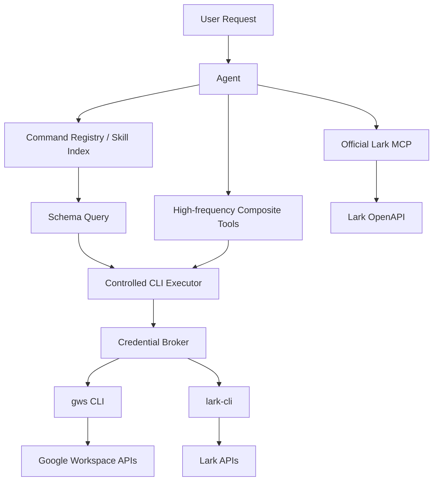

# CLI / MCP 接入 Google Workspace 与 Lark/Feishu 的调研报告

日期：2026-05-26

## 1. 调研目标

本报告调研 Google Workspace 与 Lark/Feishu 生态中，CLI、Agent Skills、MCP Server 三类接入方式的真实能力边界、官方推荐方向、用户隔离风险和对当前项目的落地建议。

重点问题：

- CLI 和 MCP 的功能完整度是否一致。
- 官方当前主推 CLI、Skills 还是 MCP。
- 是否可以直接接入 CLI 自带 server/MCP 功能。
- 多用户部署场景下是否支持用户隔离。
- 当前项目应采用什么架构，避免为每个功能手写专用工具函数。

## 2. 核心结论

### 2.1 Google Workspace

Google Workspace 当前更适合采用 `gws CLI + Agent Skills + schema/命令注册表 + 受控通用 executor`。

原因：

- 当前官方 `googleworkspace/cli` 仓库定位为面向 humans 和 AI agents 的 Google Workspace CLI，并提供 100+ Agent Skills。
- `gws` 历史版本确实提供过 `gws mcp`，但当前版本线已移除该命令。本项目本地源码为 `lib/gws-cli-v0.22.5`，源码入口未包含 `mcp` 子命令。
- 第三方 Google Workspace MCP 项目存在，但通常不是官方 `gws` 全量能力的等价替代，覆盖范围、认证模型、用户隔离实现都需要单独审查。

结论：Google Workspace 不建议押注“CLI 自带 MCP Server”。更稳妥的是把 `gws` CLI 作为底层能力，通过本项目自建的命令发现、schema 查询、参数校验、用户隔离执行层暴露给 agent。

### 2.2 Lark/Feishu

Lark/Feishu 当前有两条官方路线：

- `larksuite/cli`：官方 CLI，面向 humans 和 AI agents，覆盖 200+ commands 和 20+ Agent Skills。
- `larksuite/lark-openapi-mcp`：官方 MCP Server，面向标准 MCP client，支持通过 MCP 暴露 Lark OpenAPI 工具。

结论：Lark/Feishu 可以同时保留两种入口：

- 标准 MCP 接入：优先使用官方 `lark-openapi-mcp`。
- Agent workflow / 本地脚本化接入：使用 `lark-cli + skills/命令注册表/通用 executor`。

二者不是简单替代关系。MCP 更标准，CLI 更适合批处理、可调试、低 token 输出和复杂 workflow。

### 2.3 用户隔离

用户隔离不是 CLI 或 MCP 自动保证的能力。必须按以下四层设计：

- 认证主体隔离：区分当前请求代表哪个用户、哪个租户、哪个应用。
- token 存储隔离：不同用户不能共享 token cache、refresh token 或 keychain namespace。
- 运行时状态隔离：CLI 执行时的 `HOME`、`XDG_CONFIG_HOME`、环境变量、临时目录必须按用户隔离。
- 工具授权隔离：同一 MCP/CLI 进程不能无约束暴露所有命令，应按用户、scope、工具白名单进行限制。

在服务端多用户部署中，直接共用一个 CLI cache 或一个长期 OAuth token 是高风险设计。

## 3. 三类接入方式对比

| 接入方式 | 代表 | 优点 | 风险/限制 | 适用场景 |
|---|---|---|---|---|
| CLI | `gws`, `lark-cli` | 能力覆盖通常更全；易调试；适合脚本化；输出可控 | 默认偏本地单用户；token/cache 容易串用户；需要自行做命令安全边界 | 本地 agent、后台 worker、受控自动化 |
| Agent Skills | Google Workspace skills, Lark CLI skills | 给 AI 提供明确步骤、命令格式、边界说明；低开发成本 | 不是运行时隔离机制；仍需要 executor 负责认证和安全 | 让模型正确选择命令、减少手写工具函数 |
| MCP Server | `lark-openapi-mcp`, 第三方 Google Workspace MCP | 标准协议；工具可被 MCP client 发现；适合集成生态 | 功能覆盖不一定等于 CLI；token 模型和多用户隔离需审查 | 标准 MCP client、Cursor/Claude/Codex 等工具生态 |

## 4. Google Workspace 调研

### 4.1 官方当前方向

公开资料显示，`googleworkspace/cli` 当前强调：

- one CLI for Google Workspace；
- built for humans and AI agents；
- 100+ built-in Agent Skills；
- 支持 Gemini CLI Extension，让 Gemini CLI agent 直接访问 `gws` commands 和 Google Workspace agent skills。

这说明官方主线是 `CLI + Skills/Gemini Extension`，而不是当前版本内置 MCP Server。

### 4.2 `gws mcp` 的版本事实

本项目本地源码和官方 changelog 的结论一致：

- 历史版本 `0.3.0` 加过 `gws mcp`，作为 MCP over stdio server。
- 历史版本 `0.5.0` 加过 `--tool-mode compact|full`。
- `0.8.0` 明确移除了 `mcp command`。
- 当前项目使用的 `gws v0.22.5` 已经没有 `mcp` 子命令。

本地验证点：

- `/Users/apple/Project/Git/adk-agents/lib/gws-cli-v0.22.5/CHANGELOG.md`
- `/Users/apple/Project/Git/adk-agents/lib/gws-cli-v0.22.5/crates/google-workspace-cli/src/main.rs`

当前 `main.rs` 中实际存在的 special commands 包括：

- `schema`
- `generate-skills`
- `auth`
- 动态 service command dispatch

未发现 `mcp` 分支。

### 4.3 功能完整度判断

`gws CLI` 更接近 Google Workspace API 的广覆盖入口，因为它基于 Google Discovery API 动态生成/调用服务命令，并提供 `schema` 能力。

第三方 Google Workspace MCP 项目可能更适合 MCP client，但功能完整度通常取决于项目维护者暴露了哪些服务和操作。不能默认认为 MCP 覆盖等同于 `gws` CLI。

### 4.4 用户隔离风险

Google Workspace CLI 的认证/缓存机制适合本地单用户终端，但在服务端多用户场景需要额外隔离。

风险点：

- 如果多个用户共享同一个系统用户、同一个 home 目录、同一个 token cache，则可能串用户。
- 如果 agent 可以自由读取环境变量或执行任意 shell，则可能泄露 OAuth token。
- 如果只用一个服务账号或一个 OAuth 授权代表所有用户，则权限语义可能不符合“用户本人操作”。

建议：

- 每次执行 `gws` 时，为当前业务用户构造隔离环境。
- 使用独立 `HOME` 或 `XDG_CONFIG_HOME`。
- 注入当前用户对应的短期 token，避免依赖全局 token cache。
- executor 不允许模型传入任意 env、任意 cwd、任意 shell 片段。
- 审计每次调用的 `user_id`、`tenant_id`、命令、scope、资源 ID、结果状态。

## 5. Lark/Feishu 调研

### 5.1 官方 CLI 方向

`larksuite/cli` 官方描述为面向 humans 和 AI Agents 的 Lark/Feishu CLI。公开 README/站点信息显示，它覆盖核心业务域，包括 Messenger、Docs、Base、Sheets、Calendar、Mail、Tasks、Meetings 等，并提供 200+ commands 和 20+ Agent Skills。

这说明官方 CLI 路线是真实存在且面向 agent 场景优化的。

### 5.2 官方 MCP 方向

`larksuite/lark-openapi-mcp` 是官方 MCP Server。公开文档显示它支持：

- `stdio`、streamable HTTP、SSE 等接入方式；
- app token / tenant token / user token 等认证模式；
- 通过 `--tools` 限定暴露给 MCP client 的工具集合；
- OAuth 场景下建议显式使用 `user_access_token`。

这说明 Lark/Feishu 的 MCP 路线也是官方支持路线。

### 5.3 功能完整度判断

`lark-cli` 与 `lark-openapi-mcp` 都围绕 Lark OpenAPI，但功能完整度不应假设完全一致。

实际差异可能来自：

- CLI 是否为某些高频场景做了组合命令或紧凑输出。
- MCP 是否暴露了对应 OpenAPI 工具。
- MCP 返回结构是否更大，导致 token 成本更高。
- CLI skills 是否提供了更明确的业务步骤和参数说明。
- 认证模式是否使用 user token 还是 tenant token。

因此：

- 要标准 MCP 生态接入，优先官方 `lark-openapi-mcp`。
- 要稳定执行复杂 workflow、减少 token、便于本地调试，`lark-cli + skills` 更有价值。

### 5.4 用户隔离风险

Lark/Feishu 的官方 MCP 在用户隔离上比普通 CLI 更容易做清晰边界，因为它显式支持 `user_access_token` 和 `tenant_access_token`。

但仍需注意：

- `token-mode auto` 可能不符合预期，建议 OAuth 用户操作显式指定 `user_access_token`。
- tenant token 代表应用/租户，不等于用户本人授权。
- MCP Server 如果作为共享进程运行，需要确认 token 是否按 session/request 隔离。
- 如果使用本地 `lark-cli`，也需要隔离配置目录、keychain/token 存储和执行环境。

建议：

- 用户本人语义的操作使用 `user_access_token`。
- 后台应用级任务才使用 `tenant_access_token`。
- 为不同用户建立独立 session/token context。
- 对 MCP 暴露的 tools 做白名单，不要一次暴露所有 OpenAPI。

## 6. 用户隔离设计建议

### 6.1 推荐的统一模型

建议在当前项目中引入 `ToolExecutionContext`，作为所有 CLI/MCP 调用的统一入口上下文。

建议字段：

```json
{
  "provider": "google_workspace | lark",
  "tenant_id": "业务租户 ID",
  "user_id": "业务用户 ID",
  "auth_subject": "user | service_account | tenant_app",
  "oauth_auth_id": "外部授权 ID",
  "allowed_tools": ["drive.files.list", "docs.documents.create"],
  "allowed_scopes": ["drive.file", "documents"],
  "execution_home": "/isolated/runtime/home/user_xxx",
  "request_id": "审计链路 ID"
}
```

### 6.2 CLI executor 的隔离要求

CLI executor 不应直接接受模型生成的 shell 字符串。应接受结构化调用：

```json
{
  "cli": "gws",
  "operation": "docs.documents.create",
  "args": {
    "title": "测试文档"
  }
}
```

executor 内部负责：

- 查命令注册表；
- 校验 operation 是否允许；
- 查询/加载 schema；
- 生成 argv 数组，而不是拼接 shell 字符串；
- 注入隔离环境变量；
- 设置独立 cwd/home/config；
- 限制超时、输出大小、文件访问范围；
- 记录审计日志。

### 6.3 MCP 接入的隔离要求

MCP 接入也不能默认安全。需要确认：

- 一个 MCP server 是否服务多个用户。
- token 是进程级、session 级还是 request 级。
- tools 是否可以按用户授权动态裁剪。
- tool call 日志是否会泄露参数和 token。
- MCP client 是否可能绕过业务授权直接调用高权限 tool。

对于 Lark MCP，建议：

- OAuth 用户操作显式配置 `--token-mode user_access_token`。
- 只暴露当前业务需要的 tools。
- 不在日志中输出 access token、refresh token、app secret。

对于 Google Workspace 第三方 MCP，接入前必须审查：

- OAuth token 存储位置；
- 是否支持多用户；
- 是否支持 per-request token；
- 是否支持 tool allowlist；
- 是否使用官方 Google OAuth scopes；
- 是否能限制 Drive/Docs/Sheets 的资源访问范围。

## 7. 对当前项目的落地方案

### 7.1 总体架构

建议采用“高频组合工具 + 通用 CLI executor + 能力注册表”的混合方案。



### 7.2 Google Workspace

建议：

- 保留少量高频组合工具：
  - 创建 Google Docs 并写入内容；
  - 创建 Google Sheets 并写入数据；
  - Drive 文件列表/搜索；
  - 权限分享。
- 其他低频能力走 `gws schema + command registry + generic executor`。
- 不依赖 `gws mcp`。
- 用户隔离由 executor 和 credential broker 负责。

### 7.3 Lark/Feishu

建议：

- 已有官方 MCP 能覆盖的场景，优先走 `lark-openapi-mcp`。
- 对需要压缩输出、批处理、复杂 workflow 的场景，使用 `lark-cli`。
- 对文档创建/编辑等高频业务链路，可以继续保留组合工具。
- 明确区分 user token 和 tenant token。

### 7.4 为什么不能完全靠“AI 自己查命令”

让 AI 临时查看 CLI help/schema 能降低手写函数数量，但不能替代工程边界。

必须保留以下控制：

- 工具白名单；
- 参数 schema 校验；
- 命令 allowlist；
- 禁止 shell 注入；
- 用户 token 隔离；
- 输出大小限制；
- 错误包装，避免异常导致对话窗口失效；
- 审计日志。

因此“万能方式”的正确形态不是让模型自由执行命令，而是：

```text
AI 查询能力说明 -> 选择 operation -> executor 校验 -> 注入用户隔离凭据 -> 执行 CLI/MCP -> 结构化返回
```

## 8. 风险清单

| 风险 | 影响 | 缓解措施 |
|---|---|---|
| 多用户共享 CLI token cache | 串用户、越权访问 | per-user HOME/XDG_CONFIG_HOME/token 注入 |
| MCP 使用 tenant token 执行用户操作 | 权限语义错误 | 用户操作强制 user_access_token |
| 模型自由拼 shell 命令 | 命令注入、数据泄露 | 结构化 argv executor + allowlist |
| MCP 暴露所有 tools | 高权限误调用 | tools allowlist + scope 校验 |
| CLI/MCP 原始异常上抛 | 对话窗口失效、用户不可恢复 | 外围统一 try/catch，返回结构化错误 |
| 第三方 MCP 覆盖不完整 | 任务失败或行为不一致 | 接入前做能力矩阵和测试 |
| 输出过大 | token 爆炸、模型误判 | compact output、分页、字段选择 |

## 9. 建议实施步骤

### 阶段一：能力登记

- 为 `gws` 建立 command registry，来源包括 `gws schema`、已有 skills、人工补充的高频组合命令。
- 为 `lark-cli` 建立 command registry，来源包括官方 skills、help 输出、项目内已用命令。
- 给每个 operation 标记：
  - provider；
  - required scopes；
  - auth subject；
  - risk level；
  - output shape；
  - 是否允许 generic executor 调用。

### 阶段二：统一 executor

- 实现结构化参数到 argv 的转换。
- 禁止模型传 shell 字符串。
- 增加 timeout、max output、JSON parse、stderr capture。
- 对所有异常包装成 `{status, message, detail, recoverable}`。

### 阶段三：用户隔离

- 引入 credential broker。
- 每次调用按 `user_id + provider + auth_id` 注入 token。
- 每个用户独立 runtime home/config。
- 审计 tool call。

### 阶段四：MCP 分流

- Lark 优先接官方 MCP，用于标准 OpenAPI 工具调用。
- Google Workspace 暂不使用内置 MCP，因为当前 `gws v0.22.5` 不支持。
- 如需 MCP 统一协议，可自建 MCP wrapper，把受控 executor 暴露成 MCP tools。

### 阶段五：回归测试

- 单用户本地测试；
- 多用户 token 隔离测试；
- tenant token / user token 权限差异测试；
- CLI 错误包装测试；
- 大输出分页/截断测试；
- 创建 Google Docs / Sheets 示例的端到端测试。

## 10. 参考资料

- Google Workspace CLI GitHub: https://github.com/googleworkspace/cli
- Google Workspace CLI Changelog: https://github.com/googleworkspace/cli/blob/main/CHANGELOG.md
- Google Workspace CLI Authentication: https://googleworkspace-cli.mintlify.app/concepts/authentication
- Gemini CLI Extensions: https://google-gemini.github.io/gemini-cli/docs/extensions/
- Lark/Feishu CLI GitHub: https://github.com/larksuite/cli
- Lark CLI Website: https://feishucli.net/en
- Lark OpenAPI MCP GitHub: https://github.com/larksuite/lark-openapi-mcp
- Lark OpenAPI MCP Introduction: https://open.larksuite.com/document/uAjLw4CM/ukTMukTMukTM/mcp_integration/mcp_introduction
- Lark MCP Configuration: https://github.com/larksuite/lark-openapi-mcp/blob/main/docs/usage/configuration/configuration.md
- Community Lark CLI: https://github.com/yjwong/lark-cli
- Community Google Workspace MCP: https://github.com/aaronsb/google-workspace-mcp
- Community Google MCP Server: https://github.com/ngs/google-mcp-server

