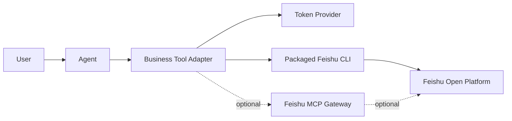

# Agent 通过飞书官方 MCP 与 CLI 操作飞书生态技术方案

## 1. 背景

Agent 要操作飞书生态，核心问题不是模型是否能“理解飞书”，而是如何把模型意图安全、稳定地落到飞书开放平台能力上。

当前可复用的官方能力主要有两类：

- **飞书官方 MCP**：通过 MCP 协议暴露飞书工具，适合被 Agent 以结构化工具形式调用。
- **飞书官方 CLI**：通过命令行封装飞书生态能力，并可进一步调用飞书 OpenAPI，适合作为本地或云端运行时的统一执行入口。

两者底层都依赖飞书开放平台能力，区别主要在接入协议、部署形态、覆盖范围、运行成本和工程治理方式。

## 2. 总体结论

推荐策略是：**CLI-first，MCP optional**。

如果项目已经可以稳定打包并执行飞书 CLI，且 CLI 已覆盖目标能力，不建议默认再混合直连 MCP。混合 MCP + CLI 会引入两套调用链、两套结果格式、两套排障路径，只有在直连 MCP 能带来明确收益时才值得保留。

直连 MCP 更适合以下场景：

- 需要把同一套飞书能力暴露给多个不同 Agent 运行时。
- 某些 MCP 工具在文档创建、更新、读取上比 CLI 更高保真或更稳定。
- 希望避免随包发布 CLI 二进制，改为协议级远程工具调用。
- 需要使用 MCP 的工具发现、工具白名单、标准 JSON-RPC 调用模型。

如果上述诉求不强，单独使用 CLI 作为主执行层更简单、更直接，也更利于快速扩展飞书生态能力。

## 3. 可行性判断

Agent 通过飞书 MCP 或 CLI 操作飞书生态是可行的，原因如下：

- 飞书开放平台提供了稳定的 OAuth、用户态 token、租户态 token 和权限模型。
- MCP 和 CLI 都可以接收用户态授权，代表当前用户执行文档、云空间、日历、任务、消息等操作。
- Agent 只需要把自然语言意图转换为有限、明确、可校验的工具参数。
- 工程侧可以通过 Adapter 层屏蔽 MCP/CLI 细节，对模型暴露稳定的业务工具。
- 写操作可以增加确认、审计、幂等、重试和权限校验，满足企业场景的治理要求。

## 4. 三种接入模式

### 4.1 CLI-only

Agent 调用业务工具，业务工具内部通过 `subprocess` 或等价运行机制执行飞书 CLI。

适用场景：

- 希望快速覆盖飞书生态的多个模块。
- 已经能稳定打包 CLI 二进制。
- 接受进程调用开销。
- 团队希望减少协议和运行组件数量。

优势：

- 接入简单，工程心智模型清晰。
- 生态覆盖通常更广，扩展 Drive、Wiki、Base、Sheets、Calendar、Task、IM 等能力更快。
- CLI 可作为 OpenAPI 的统一补位入口，减少手写大量 REST Client。
- 可以随应用一起版本锁定和部署，避免远端工具版本不可控。

劣势：

- 需要处理二进制平台兼容，例如本地 macOS 与云端 Linux 架构不同。
- 每次调用有进程启动成本。
- 需要规范化 stdout、stderr、退出码和 JSON 输出。
- 需要严格限制模型可传入的参数，不能让模型自由拼接命令。

### 4.2 MCP-only

Agent 直接通过 MCP 协议调用飞书官方 MCP 工具。

适用场景：

- Agent 运行时原生支持 MCP。
- 飞书 MCP 已覆盖项目所需的主要能力。
- 希望通过统一协议治理工具发现、工具调用和权限白名单。
- 不想打包和维护 CLI 二进制。

优势：

- 协议标准化，天然适合 Agent 工具调用。
- JSON-RPC 调用模型清晰，工具名和参数边界明确。
- 适合文档类、高保真内容类工具。
- 便于跨 Agent 运行时复用同一套飞书工具。

劣势：

- 覆盖范围可能不如 CLI 或 OpenAPI 灵活。
- 需要处理 MCP 网关、headers、allowed tools、token 传递等协议细节。
- 如果 Agent 运行时不原生支持 MCP，需要自行实现 JSON-RPC 调用层。
- 当 CLI 已经覆盖同一能力时，直连 MCP 会产生重复路径。

### 4.3 CLI-first + selective MCP

以 CLI 作为默认执行层，只在少数能力上直连 MCP。

适用场景：

- CLI 已经覆盖大多数飞书生态能力。
- 某些文档类能力通过 MCP 更高保真、更稳定或更容易拿到结构化结果。
- 团队可以接受少量双路径维护成本。

优势：

- 兼顾 CLI 的广覆盖和 MCP 的协议化优势。
- 可以按能力逐步验证，不需要一次性迁移。
- 适合从实验阶段过渡到生产阶段。

劣势：

- 架构复杂度高于 CLI-only。
- 同一类能力如果同时存在 CLI 和 MCP 实现，容易出现行为不一致。
- 排障时需要判断问题发生在 Agent、Adapter、CLI、MCP 网关还是飞书 OpenAPI。

## 5. 推荐架构

推荐采用 **CLI-first** 架构：

关键原则：

- Agent 不直接接触原始 CLI 命令。
- Agent 不直接拼接 MCP JSON-RPC payload。
- 对模型只暴露稳定业务工具，例如 `create_document`、`append_document`、`search_docs`、`send_message`。
- Adapter 内部决定走 CLI、MCP 或 OpenAPI。
- 同一项能力只保留一个主路径，避免 CLI 和 MCP 并行实现造成行为分裂。

## 6. MCP 与 CLI 的分工建议

| 能力类型 | 推荐路径 | 原因 |
| --- | --- | --- |
| 文档搜索、云空间、Wiki、Base、Sheets、日历、任务、IM | CLI | 覆盖广，扩展快，便于统一调用 |
| 任意飞书 OpenAPI 补位 | CLI / OpenAPI | CLI 可作为低成本验证入口，成熟后沉淀专用工具 |
| 高保真文档创建、更新、读取 | CLI 优先，必要时 MCP | 若 CLI 已满足，不必额外直连 MCP；若 MCP 效果明显更好再保留 |
| 多 Agent 运行时共享飞书工具 | MCP | MCP 协议更适合作为跨运行时工具层 |
| 高频、低延迟固定工具 | MCP 或原生 OpenAPI | 避免进程启动开销，但要评估维护成本 |

## 7. 是否还需要混合 MCP

不建议把“混合 MCP + CLI”作为默认目标。

当前更合理的判断是：

- **如果 CLI 已具备全部能力，先做 CLI-only。**
- **如果某个能力用 CLI 表现不稳定、结果不够高保真、或调用成本过高，再为该能力单独引入 MCP。**
- **不要因为 MCP 是 Agent 标准协议，就把所有能力强行迁移到 MCP。**

换句话说，MCP 不是不推荐，而是不推荐在 CLI 已满足需求时无差别混用。MCP 应该是清晰收益驱动的增强路径，而不是默认复杂化架构。

## 8. Adapter 设计要求

无论选择 CLI 还是 MCP，都应该在 Agent 和飞书能力之间增加 Adapter 层。

Adapter 需要负责：

- 参数校验：限制 doc_id、URL、路径、method、body 等字段格式。
- 权限控制：根据用户态 token 和业务策略决定是否允许执行。
- 输出归一化：把 CLI stdout、MCP content、OpenAPI JSON 统一为稳定结构。
- 错误映射：把 401、403、404、429、5xx、超时等错误转成可被 Agent 理解的消息。
- 审计记录：记录写操作的用户、目标资源、参数摘要、结果和失败原因。
- 幂等与重试：对创建、更新、发送消息等写操作设计幂等键或确认机制。

不建议让模型自由执行：

- 任意 CLI 命令。
- 任意 shell 参数。
- 任意 MCP tool name。
- 任意 OpenAPI path + method + body。

通用 OpenAPI 工具可以保留，但应作为开发期或受控补位能力，并增加白名单和审计。

## 9. 认证与权限

飞书生态操作通常涉及两类 token：

- **用户态 token**：代表当前用户访问文档、日历、任务、消息等资源，更适合 Agent 个人助手场景。
- **租户态 token**：代表应用或租户执行管理类操作，更适合后台自动化和企业级管理场景。

建议：

- 默认优先使用用户态 token。
- 对写操作使用最小权限 scope。
- 不在日志中输出 access token、refresh token、App Secret。
- token 过期时走统一刷新或重新授权流程。
- 对跨用户、跨群、跨空间操作增加显式确认。

## 10. 部署注意事项

CLI-first 需要重点关注：

- 云端运行环境的 OS 与 CPU 架构，通常需要 Linux x86_64 或目标平台对应二进制。
- CLI 二进制随包发布后要确保可执行权限。
- 大二进制会增加构建、上传和冷启动风险，需要控制包体积。
- CLI 版本应锁定，避免不同环境行为不一致。
- 运行 CLI 时使用隔离 `HOME`，避免用户状态、缓存、配置互相污染。
- 通过环境变量或 stdin 注入 token，不要写入持久化配置文件。

MCP-first 或 selective MCP 需要重点关注：

- MCP 网关地址和网络连通性。
- allowed tools 白名单。
- token header 传递方式。
- MCP result content 的解包和错误处理。
- 远端工具版本变化带来的兼容性。

## 11. 演进路线

建议按以下顺序推进：

1. **P0：CLI-only 主路径**  
   固化 CLI 打包、执行、鉴权、输出归一化和错误处理；先覆盖文档创建、更新、读取、搜索和通用 OpenAPI 补位。

2. **P1：沉淀稳定业务工具**  
   将常见高频操作封装为明确工具，例如创建文档、追加文档、搜索文档、发送消息、创建日程、创建任务。

3. **P2：权限与审计治理**  
   对所有写操作增加确认策略、审计日志、失败重试、幂等控制和资源权限校验。

4. **P3：评估 selective MCP**  
   只在 CLI 无法满足或 MCP 明显更优的能力上引入直连 MCP，例如特定高保真文档编辑或跨 Agent 工具复用。

5. **P4：能力标准化**  
   将稳定能力抽象成统一 Tool Contract，使底层 CLI、MCP、OpenAPI 可以替换，但不影响 Agent 侧使用。

## 12. 最终建议

对于当前阶段，最务实的方案是：

**用飞书 CLI 作为 Agent 操作飞书生态的主执行层；把 MCP 作为可选增强能力，而不是默认混合依赖。**

这样可以最大化复用飞书官方能力，同时降低工程复杂度。后续是否引入直连 MCP，应由具体能力的稳定性、保真度、性能和复用收益决定，而不是由协议偏好决定。
