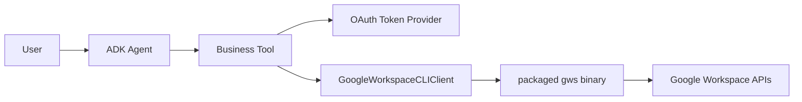

# Google Workspace CLI 接入设计方案

## 目标

在现有飞书 CLI 接入模式基础上，横向扩展 Google Workspace 能力，让 Agent 可以通过自然语言安全操作 Google Drive、Docs、Sheets、Calendar 等产品。

本阶段目标是完成最小可用接入：

- 复用 ADK / Gemini Enterprise OAuth 注入的当前用户 Google access token。
- 通过随包发布的 `gws` 二进制执行 Google Workspace 操作。
- 对 Agent 暴露稳定业务工具，而不是任意 CLI 命令。
- 建立可继续扩展其他 CLI 的通用执行基座。

## 关键判断

Google Workspace CLI `gws` 可作为本项目第二个 CLI 能力层，原因是：

- 覆盖 Drive、Docs、Sheets、Calendar、Gmail、Chat、Admin 等 Workspace API。
- 默认输出结构化 JSON，适合 Agent 工具调用。
- 支持 `GOOGLE_WORKSPACE_CLI_TOKEN` 直接注入预先获取的 OAuth access token。
- 提供 helper 命令，例如 `docs +write`、`sheets +append`、`calendar +agenda`。

主要限制：

- `gws` v0.22.5 明确不是 Google 官方正式支持产品，需要按开源工具治理。
- 命令面基于 Google Discovery Service 动态生成，首次或缓存失效时需要访问 Google Discovery API。
- Access token 过期刷新不由 `gws` 负责，应由 ADK / GE OAuth 集成负责。
- 交互式 `gws auth login/setup` 不适合云端 Agent Engine / Cloud Run 环境。

## 授权模型

推荐主路径：

```text
Gemini Enterprise OAuth
  -> tool_context.state[GOOGLE_WORKSPACE_AUTH_ID]
  -> GOOGLE_WORKSPACE_CLI_TOKEN
  -> gws command
```

新增配置：

```env
GOOGLE_WORKSPACE_AUTH_ID="google-workspace-oauth_v1"
GOOGLE_WORKSPACE_PROJECT_ID="optional-gcp-project-id"
```

必须由 OAuth App 申请实际工具所需 scopes，例如：

- Drive 查询：`https://www.googleapis.com/auth/drive.metadata.readonly` 或 `https://www.googleapis.com/auth/drive.readonly`
- Docs 写入：`https://www.googleapis.com/auth/documents`
- Sheets 读写：`https://www.googleapis.com/auth/spreadsheets`
- Calendar 读写：`https://www.googleapis.com/auth/calendar`

不推荐在生产运行时使用：

- `gws auth login`
- `gws auth setup`
- 本地 OS keyring
- 明文 refresh token 文件作为多用户共享凭据

## 架构



## 执行层设计

新增通用 `PackagedCLIClient`：

- 解析 CLI 二进制路径。部署和本地运行统一使用 `lark_agent/bin/<name>`。
- 自动修复可执行权限。
- 使用 `subprocess.run` 且不启用 shell。
- 为每次调用创建隔离 `HOME`。
- 支持 timeout。
- 解析 JSON / NDJSON / 文本输出。
- 归一化错误码、stderr 和 stdout。

`GoogleWorkspaceCLIClient` 在此基础上注入：

- `GOOGLE_WORKSPACE_CLI_TOKEN`
- `GOOGLE_WORKSPACE_CLI_CONFIG_DIR`
- `GOOGLE_WORKSPACE_CLI_KEYRING_BACKEND=file`
- `GOOGLE_WORKSPACE_PROJECT_ID`
- `NO_COLOR=1`

## 暴露给 Agent 的首批工具

| 工具 | 底层命令 | 说明 |
| --- | --- | --- |
| `search_google_drive_files` | `gws drive files list` | 搜索当前用户 Drive 文件 |
| `append_google_doc_text` | `gws docs +write` | 向 Google Docs 追加纯文本 |
| `read_google_sheet_range` | `gws sheets +read` | 读取表格范围 |
| `append_google_sheet_rows` | `gws sheets +append` | 追加一行或多行表格数据 |
| `list_google_calendar_events` | `gws calendar +agenda` | 查询未来日程 |
| `create_google_calendar_event` | `gws calendar +insert` | 创建日程，可加参会人和 Meet |
| `discover_google_workspace_operations` | `gws ... --help` | 发现服务、资源和可执行操作 |
| `get_google_workspace_operation_schema` | `gws schema ...` | 获取指定 API 方法 schema |
| `execute_google_workspace_cli` | 受控 `gws` argv | 执行长尾 Google Workspace 操作 |

通用执行工具不是任意 shell。它只接受 JSON 字符串数组形式的 argv，并增加以下限制：

- 第一个参数必须是允许的 Google Workspace service 或安全 meta command。
- 禁止绝对路径、`..` 路径穿越和输出路径类 flag。
- 写操作默认自动追加 `--dry-run`。
- 如需真正执行写操作，必须显式设置 `allow_mutating=True`。
- `timeout_seconds` 有上限，避免长时间挂起。

## 部署要求

需要将 release 页对应云端平台的 `gws` 二进制放入：

```text
lark_agent/bin/gws
```

并确保 `pyproject.toml` package-data 包含：

```toml
lark_agent = ["bin/lark-cli", "bin/gws"]
```

Agent Engine 常见目标是 Linux x86_64，应使用 release 中的 Linux GNU 或 MUSL 产物，避免误用 macOS arm64 二进制。

当前不再维护项目根目录 `bin/` 作为本地覆盖目录，避免本地和部署二进制版本/架构分裂。如后续恢复本地 CLI 调试，应通过显式参数或独立脚本临时指定本机二进制，而不是改变默认解析路径。

## 风险控制

- 默认限制 Drive 搜索 `page_size <= 25`。
- Calendar 查询 `days <= 31`。
- Docs 写入首期仅支持纯文本追加，不支持任意 batchUpdate。
- Sheets 追加通过 `values_json` 传 JSON 数组字符串，避免 Vertex 工具 schema 的数组兼容问题。
- 所有命令走 argv 数组，不允许 shell 拼接。
- Google Workspace 通用执行工具只接受 `args_json`，不接受自由文本命令。
- 错误信息保留给用户，便于定位 401/403/scope 问题。

## 后续扩展

后续可按同一模式接入 Gmail、Chat、Tasks、Admin、Slides，并逐步增加：

- Google Docs 创建文档。
- Google Docs Markdown 转换写入。
- Google Drive 文件导出。
- Gmail 草稿优先而非直接发送。
- 继续收紧通用执行工具的 service / method 白名单和审计记录。
