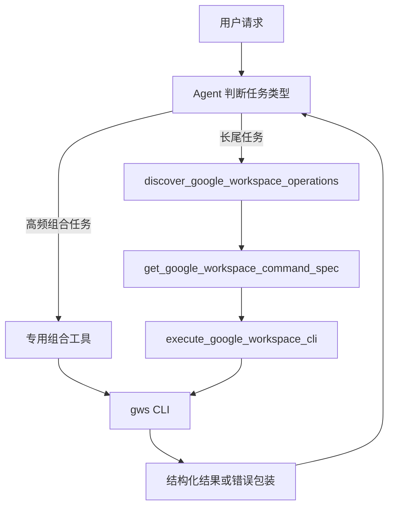

# Google Workspace CLI 通用执行方案

## 背景

当前 Google Workspace 能力通过随包发布的 `gws` CLI 提供。前期为了快速验证，已经封装了一批专用工具，例如 Drive 搜索、Docs 写入、Sheets 追加、Calendar 创建日程等。

随着能力范围扩大，如果每个 `gws` 命令都写一个 Python 工具函数，会出现几个问题：

- 工具数量膨胀，维护成本高。
- 长尾 Google Workspace API 很难覆盖完整。
- 模型在缺少命令规范时会临场调用 `gws schema ...`，容易把 Google Discovery schema 的 `$ref` 字段直接回灌给 Gemini。
- 近期日志中已经出现 `File` / `Tab` 被误判为 `function_response.parts` 文件引用，导致 `400 INVALID_ARGUMENT`，并使 Gemini Enterprise 对话窗口进入不可继续状态。

目标是把架构调整为：

```text
少量高频组合工具 + 本地命令索引 + 命令规范查询 + 受控通用 CLI 执行器
```

## 设计原则

1. 不为每个 CLI 命令写专用函数。
2. 专用函数只保留高频、多步骤、容易出错的业务组合。
3. 长尾能力统一走命令索引和通用执行器。
4. 模型不能直接拼 shell，只能输出结构化 argv。
5. 写操作默认 dry-run，必须显式确认后才允许真实执行。
6. 原始 Google Discovery schema 不直接以嵌套 JSON dict 回灌给模型。
7. 所有工具异常必须包装为 `{status, message, details}`，避免异常冒泡打断对话流。

## 目标架构



## 保留的高频组合工具

这些工具不是单条 CLI 命令，而是多步骤流程。保留专用封装可以减少模型串联失败。

| 工具 | 内部步骤 | 保留原因 |
| --- | --- | --- |
| `create_google_doc_with_text` | `docs documents create` -> 提取 `documentId` -> `docs +write` | 创建和写入是连续流程，中间需要解析 ID |
| `create_google_sheet_with_rows` | `sheets spreadsheets create` -> 提取 `spreadsheetId` -> `sheets +append` | 创建和追加是连续流程，中间需要解析 ID |
| `search_google_drive_files` | `drive files list` + 安全 query 构造 | 搜索是高频入口，需要限制 page size 和字段 |
| `list_google_calendar_events` | `calendar +agenda` | 高频只读工具，参数简单 |
| `create_google_calendar_event` | `calendar +insert` + 时间/参会人处理 | 写操作高频，参数需要规范化 |

## 通用工具设计

### 1. `discover_google_workspace_operations`

用途：从本地命令索引中检索可用能力。

输入建议：

```python
def discover_google_workspace_operations(
    query: str,
    service: str = "",
    intent: str = "",
) -> dict:
    ...
```

返回示例：

```json
{
  "status": "success",
  "matches": [
    {
      "command_id": "docs.documents.create",
      "service": "docs",
      "kind": "write",
      "description": "Create a Google Docs document",
      "argv_template": ["docs", "documents", "create", "--json", "<json-body>"],
      "example": ["docs", "documents", "create", "--json", "{\"title\":\"测试文档\"}"]
    }
  ]
}
```

### 2. `get_google_workspace_command_spec`

用途：返回单个命令的参数规范、示例和安全策略。

输入建议：

```python
def get_google_workspace_command_spec(command_id: str) -> dict:
    ...
```

返回示例：

```json
{
  "status": "success",
  "command_id": "sheets.spreadsheets.create",
  "kind": "write",
  "argv_template": ["sheets", "spreadsheets", "create", "--json", "<json-body>"],
  "input_notes": "Use --json with {\"properties\":{\"title\":\"...\"}}",
  "examples": [
    ["sheets", "spreadsheets", "create", "--json", "{\"properties\":{\"title\":\"测试表格\"}}"]
  ],
  "requires_confirmation": true
}
```

注意：这里返回的是摘要和示例，不返回完整 Discovery schema dict。如果确实需要完整 schema，放在字符串字段 `schema_json` 中。

### 3. `execute_google_workspace_cli`

用途：统一执行结构化 argv。

已有方向基本正确，继续保留以下约束：

- 输入必须是 JSON array string。
- 禁止 `shell=True`。
- 第一段参数必须是允许的 service 或安全 meta command。
- 阻止危险 flag，例如 `--output`、`--credentials-file`、`--upload-file` 等。
- 写操作默认追加 `--dry-run` 或直接拒绝，除非 `allow_mutating=True`。
- 捕获所有异常并返回结构化错误。

返回错误示例：

```json
{
  "status": "error",
  "message": "Google Workspace CLI execution failed.",
  "details": {
    "exit_code": 1,
    "stderr": "..."
  }
}
```

## 命令索引文件

新增目录：

```text
lark_agent/gws_registry/
```

新增文件：

```text
lark_agent/gws_registry/commands.json
```

建议结构：

```json
{
  "docs.documents.create": {
    "service": "docs",
    "argv": ["docs", "documents", "create"],
    "kind": "write",
    "description": "Create a Google Docs document",
    "input_notes": "Use --json with {\"title\":\"...\"}",
    "examples": [
      {
        "args": ["docs", "documents", "create", "--json", "{\"title\":\"测试文档\"}"]
      }
    ],
    "requires_confirmation": true
  },
  "sheets.spreadsheets.create": {
    "service": "sheets",
    "argv": ["sheets", "spreadsheets", "create"],
    "kind": "write",
    "description": "Create a Google Sheets spreadsheet",
    "input_notes": "Use --json with {\"properties\":{\"title\":\"...\"}}",
    "examples": [
      {
        "args": ["sheets", "spreadsheets", "create", "--json", "{\"properties\":{\"title\":\"测试表格\"}}"]
      }
    ],
    "requires_confirmation": true
  }
}
```

## 命令索引生成脚本

新增脚本：

```text
scripts/build_gws_command_index.py
```

数据来源优先级：

1. `lib/gws-cli-v0.22.5/skills/**/SKILL.md`
2. `lib/gws-cli-v0.22.5/crates/google-workspace-cli/src/helpers/*.rs`
3. 必要时调用 `gws schema <method>`，但只保存摘要和示例，不直接保存完整嵌套 schema 给模型使用

脚本职责：

- 扫描技能文档中的命令示例。
- 提取 `gws <service> ...` 命令。
- 标记 read/write/mutate 类型。
- 生成 `commands.json`。
- 对高风险命令标记 `requires_confirmation=true`。

## Agent 提示词调整

在 `lark_agent/agent.py` 中修改 Google Workspace 行为规则：

```text
When operating Google Workspace:
1. Prefer dedicated high-level tools for common workflows.
2. For long-tail operations, first use discover_google_workspace_operations.
3. Then call get_google_workspace_command_spec to confirm argv format.
4. Only then call execute_google_workspace_cli with a JSON array of argv.
5. Do not call get_google_workspace_operation_schema unless command registry has no match.
6. Never invent shell commands.
7. Mutating operations require dry-run or explicit confirmation.
```

## 错误包装策略

### 工具层

所有 Google Workspace 工具都必须返回 dict，不允许异常冒泡：

```python
{
    "status": "error",
    "message": "...",
    "step": "...",
    "details": {...}
}
```

多步骤工具需要带 `step`：

- `create_google_doc`
- `write_google_doc`
- `create_google_sheet`
- `append_google_sheet_rows`

### ADK FunctionResponse 层

保留当前修复：

- 普通工具结果走 ADK 原始 `__build_response_event`。
- 只有工具返回 `__multimodal_parts__` 时才注入 `FunctionResponse.parts`。
- `gws schema` 结果不得以原始嵌套 dict 回灌。

### Gemini Enterprise 对话层

如果底层模型请求仍然 400，应用层不一定能恢复已经失效的旧会话。可控目标是让工具和 FunctionResponse 不再制造 400，从而让新会话不会进入只读状态。

## 实施步骤

### 阶段 1：止血

已完成或应优先完成：

- 修复 `callbacks.py`，普通工具结果回退 ADK 原始构造。
- 修复 `get_google_workspace_operation_schema`，将 schema 作为字符串返回。
- 给 `_run_google_workspace_cli` 增加异常包装。
- 保留 `create_google_doc_with_text` 和 `create_google_sheet_with_rows`。

验证：

```bash
uv run python -m py_compile lark_agent/tools.py lark_agent/agent.py lark_agent/callbacks.py
uv run pytest tests/test_google_workspace_cli_tools.py tests/test_callbacks.py
```

### 阶段 2：命令索引

新增：

```text
scripts/build_gws_command_index.py
lark_agent/gws_registry/commands.json
tests/test_gws_registry.py
```

实现：

- 扫描 `lib/gws-cli-v0.22.5/skills/**/SKILL.md`。
- 提取命令、用途、示例。
- 生成功能索引。

### 阶段 3：查询工具

新增或重构：

```python
discover_google_workspace_operations(query, service="", intent="")
get_google_workspace_command_spec(command_id)
```

注意：旧的 `discover_google_workspace_operations(service, resource)` 可以保留兼容，但内部优先查 registry，而不是直接执行 `gws --help`。

### 阶段 4：Agent 行为收敛

更新 `agent.py`：

- 高频任务使用专用组合工具。
- 长尾任务先查 registry。
- 禁止直接猜测 `gws schema` 或 raw CLI 参数。

### 阶段 5：部署验证

部署：

```bash
bash deploy.sh
```

验证场景：

1. 创建 Google Docs 并写入测试内容。
2. 创建 Google Sheets 并追加测试数据。
3. 查询 Drive 文件。
4. 长尾命令通过 registry 查询后 dry-run。
5. 故意给错误参数，确认返回结构化错误而不是对话只读。

## 风险和边界

- `gws` 的命令面来自 Google Discovery，未来版本可能变化，`commands.json` 需要随 `gws` 版本更新。
- 某些 Google Workspace 写操作需要额外 OAuth scope，工具只能返回权限错误，不能自动补授权。
- 已经被 Gemini Enterprise 标记只读的旧会话通常无法在代码层恢复。
- 如果 GE Agent 指向已删除的 Reasoning Engine，需要通过 `scripts/update_agent_GE.sh` 或 PATCH API 重新绑定现存 Reasoning Engine。

## 推荐最终形态

长期保留：

```text
create_google_doc_with_text
create_google_sheet_with_rows
search_google_drive_files
list_google_calendar_events
create_google_calendar_event
discover_google_workspace_operations
get_google_workspace_command_spec
execute_google_workspace_cli
```

逐步减少一命令一函数式封装，把新增能力纳入 `commands.json` 和通用执行器。
