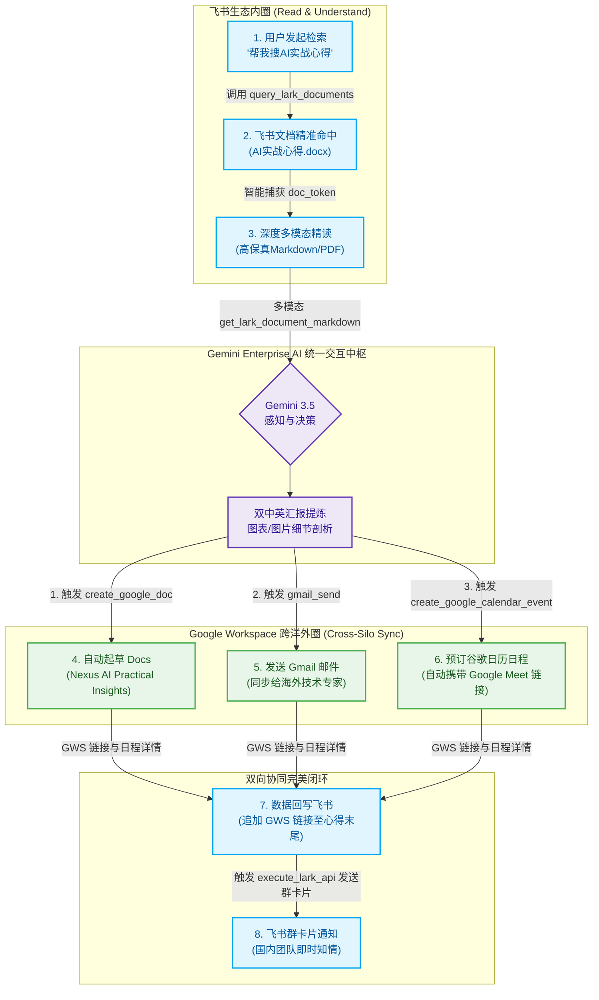
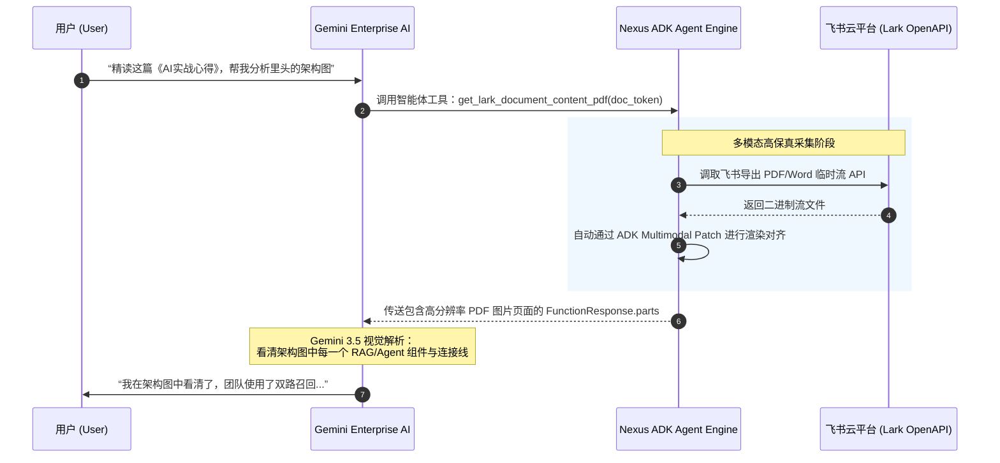

# 🎨 WebEye Nexus Agent - 展会演示图例与流程视觉资产包

本资产包旨在为 **Google Cloud Startup Day** 展位的解决方案展示提供强有力的视觉支持。资产包中包含：
1. **概念主视觉 (Key Visual Poster)**：用于宣传海报、视频封面或 PPT 胶片，直观展现 Gemini 破除孤岛的能力。
2. **多模态提炼流时序图 (Multimodal Extraction Flow)**：展示 Agent 如何解析飞书图文并进行决策。
3. **Demo 演示步骤流程图 (Interactive Demo Step-by-Step Flow)**：直观清晰地表达“读 - 悟 - 写 - 跨域闭环”的全程流向。

---

## 🌌 1. 概念主视觉海报

我们使用 AI 生成了一张极具科技感、符合 Google Cloud 高端审美的主视觉图例（已保存在本地，可直接用于易拉宝或视频片头）。


> **设计内涵**：
> * **中心核心**：Brilliant 3D Holographic Core，代表部署在 GCP 上的 **Gemini Enterprise AI (Vertex AI)** 统一智能大脑。
> * **左侧面板**：Sleek Glassmorphism Panel，代表**飞书（Feishu/Lark）**高效的国内协同文档、IM与群组。
> * **右侧面板**：Google Workspace 标志性配色（蓝、红、黄、绿）组成的几何体，代表 **GWS (Gmail、Docs、Calendar)** 全球协作套件。
> * **连接纽带**：金色与霓虹蓝的光纤数据轨，象征着数据流无缝跨越，代表**“打破数据孤岛 (Breaking Data Silos)”**。

---

## 🏆 2. 核心演示

针对国内演示场景、多屏展示或演示视频中的动画过渡，我们特地生成了这款**“全中文、极速易懂、极具科技视觉震撼力”**的 4 步操作大图（已保存在本地，推荐作为宣传幻灯片的展示页）。


> **极客步骤视觉解析**：
> * **第一步：多模态智能检索**：左上方磨砂玻璃终端正在扫描一份飞书文档，智能接入全域非结构化数据，精准提取段落文字、表格排版以及嵌套的 AI 架构图片。
> * **第二步：Gemini 智能提炼**：中心的 3D 全息大脑网络代表 **Gemini 神经网络大脑**，以毫秒级速度深入理解语义，进行自然语言处理、多语言翻译以及核心知识洞察的智能提炼。
> * **第三步：跨生态联动同步**：多条高能光纤脉络从大脑中枢同时向外发射，一瞬间自动在海外生态侧创建 Google Docs 总结文档、起草并发送 Gmail、并在谷歌日历上预订带有 Google Meet 视频会议地址的日程。
> * **第四步：双向协同闭环**：一条亮丽的青绿色回写弧线反向穿梭回飞书端，反向更新源头，优雅地将生成的 GWS 链接贴回原飞书文档末尾，并在飞书 IM 中即时弹出酷炫绿色的交互卡片通知，宣告协作闭环。

---

## 🧬 3. 现场 Demo 演示步骤流程图

为了让展台观众或技术高管一眼看懂整个 Demo 在 4 步交互中，底层数据和控制流是如何在 **Lark** 和 **Google Workspace** 之间穿梭的，我们设计了如下极简、美观的 Mermaid 流程图例：



---

## 📊 3. 多模态技术细节提炼时序图

如果需要向 Google 官方人员展示我们利用 ADK 高保真传输多模态 PDF 的高级特性，可以使用以下时序图。它直观展示了智能体如何解决**“大模型读不懂云文档内插图”**这一行业痛点。


---

## 🎯 4. 演示剧本

### 📋 演示前置假设：
您的飞书云文档中存在一篇名为 **《AI实战心得》** 的文档，其中可能包含了：
1. **实战成果**（如 RAG 优化、Prompt 调优）。
2. **踩坑记录与挑战**（如 API 超时、模型幻觉）。
3. **架构图/配图**（如 Agent 执行流图、RAG 检索流程图）。
4. **下一步行动计划 (Next Steps)**（如在 Google Cloud 上部署 Vertex AI 实例、与海外团队同步）。

---

### 🚀 演示流程设计 (4大步骤，一气呵成)

#### 第一步：飞书生态智能检索 🔍
* **用户输入 (Prompt)**：
  ```text
  帮我搜索飞书上关于“AI实战心得”的文档，看看我们之前总结了哪些核心要点。
  ```
* **时机与节奏**：演示开始，展示智能体在不离开对话框的情况下，跨越飞书庞大云空间进行秒级精准定位的能力。
* **智能体后台调用**：`query_lark_documents(query="AI实战心得")`
* **预期效果**：
  * 智能体精确返回一个优雅的 Markdown 卡片，突出显示：
    #### 1. [AI实战心得](https://open.feishu.cn/...) (docx)
    > **预览**: 本文档汇总了团队在 **AI 实战** 中的核心心得，包括 RAG 架构调优与 Agent 落地经验...
  * 同时，智能体在后台悄悄获取并锁定了这篇文档的 `doc_token` 和 `doc_type`。

---

#### 第二步：多模态内容精读与中英双语提炼 🧠
* **用户输入 (Prompt)**：
  ```text
  请帮我精读这篇《AI实战心得》文档。
  1. 提炼出我们在实战中遇到的 3 个最大痛点和对应的解决方案；
  2. 如果文档里有架构图、流程图等图片，请帮我分析图片展现的技术细节；
  3. 将总结提炼为一份精美的中英双语汇报摘要。
  ```
* **时机与节奏**：展示智能体对富文本、表格以及多模态图片（通过 Vertex AI 视觉能力）的强大理解与结构化输出能力。
* **智能体后台调用**：
  * 首先调用 `get_lark_document_markdown` 读取文档结构和表格。
  * 若检测到图片资产，智能体自动调用 `get_lark_document_content_pdf` 将文档以高保真 PDF 载入多模态上下文，由 Gemini 视觉大模型进行直接“看图解析”。
* **预期效果**：
  * 智能体输出一份排版精美、重点突出的中英双语报告。
  * **震撼点**：如果您的文档里有 RAG 架构图，智能体会直接说：*“在文档包含的 [📷 架构图] 中，我注意到团队采用了双路召回（BM25 + 向量检索）并在重排阶段引入了 Rerank 模型，这有效解决了痛点...”* 展现极强的数据感知能力。

---

#### 第三步：打破孤岛！跨域联动 Google Workspace 🌉
* **用户输入 (Prompt)**：
  ```text
  海外总部的技术专家对我们的这份实战心得非常感兴趣。请帮我：
  1. 将刚才提炼的中英双语摘要自动生成一份 Google Docs 文档，标题为 “Nexus Team - AI Practical Insights 2026”；
  2. 给海外技术专家 `test_colleague@company.com` 发送一封英文 Gmail 邮件，抄送给我自己，简单说明这是我们的最新心得，并附上 Google Docs 链接；
  3. 帮我在 Google Calendar 中建一个下周一早上 10 点的技术评审会议（时长1小时），加上我们俩，生成 Google Meet 视频链接。
  ```
* **时机与节奏**：这是整场演示的**高潮**。一句话同时调动 Google Workspace 的三大底层能力（Docs、Gmail、Calendar），展现真正的数据破局。
* **智能体后台调用**：
  * `create_google_doc_with_text` (写入 Docs 并获取链接)
  * `execute_google_workspace_cli` (运行 `gmail +send` 发送邮件)
  * `create_google_calendar_event(..., add_meet=True)` (创建日程和 Meet 链接)
* **预期效果**：
  * 智能体有条不紊地逐项执行，并返回：
    * **Google Docs 地址**：`https://docs.google.com/document/d/...`
    * **Gmail 发送状态**：`已成功向 test_colleague@company.com 发送邮件。`
    * **Google 日历日程及 Meet 会议链接**。
  * 此时打开测试 Gmail 邮箱和谷歌日历，两端已同步渲染完毕，全自动化完成。

---

#### 第四步：协同闭环，回写飞书通知国内团队 🔄
* **用户输入 (Prompt)**：
  ```text
  太棒了，海外沟通已全部安排好。为了让国内团队知情，请：
  1. 将刚才生成的 Google Docs 链接、Calendar 邀约和 Meet 视频链接，以“任务跟进列表”的形式追加写回到我们第一步的那篇飞书《AI实战心得》文档的末尾；
  2. 并给我们的飞书群发一条通知。
  ```
* **时机与节奏**：演示收尾。向观众展现这是一个完整的双向循环：信息来源于飞书，流转于 Google Workspace，最后闭环归档于飞书。
* **智能体后台调用**：
  * `save_ai_output_to_existing_feishu_doc` (将 GWS 链接作为 Append 追加到原有飞书文档末尾)
  * `execute_lark_api` (向飞书 IM 发送卡片消息)
* **预期效果**：
  * 智能体轮询写入任务，最终提示：*“追加写入成功！飞书群通知已同步发送。”*
  * 刷新您的飞书云文档《AI实战心得》，会发现最底部出现了一个漂亮的【海外同步进展】章节，整齐地列着刚才生成的 Google 日历、Meet 链接。飞书群里也同步收到了机器人的消息提醒。

---

### 💡 演示调优小贴士（Tips for Success）

1. **“双开”分屏演示**：
   在展位显示器上，左边放 **Gemini Enterprise (ADK Web)** 的交互窗口，右边同时并排打开 **飞书云文档** 和 **Google Calendar/Gmail**。这样观众可以亲眼看到，在左边打完字后，右边两套生态里的内容“像魔法一样”自动生长。
2. **多模态图表准备**：
   如果您的《AI实战心得》里有配图，请确保图中的文字清晰（Gemini 3.5 的 OCR 能力极强，可以直接抓取图中的英文术语进行提炼）。
3. **容错与超时控制**：
   在内测时，如果发现 `wait_for_feishu_doc_update_task` 轮询时间过长，可以在 Prompt 里加入：*“异步后台写入即可，不需要等写入完成，直接返回任务 ID 告诉我已提交。”* 这在展会网络拥堵时，能让 Demo 展现出更流畅的反应速度。